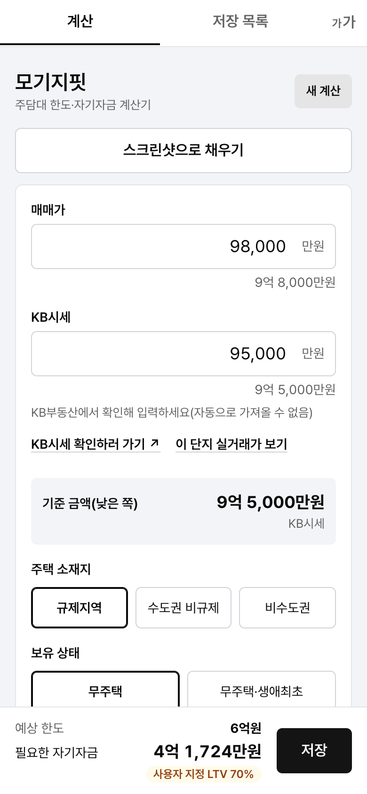
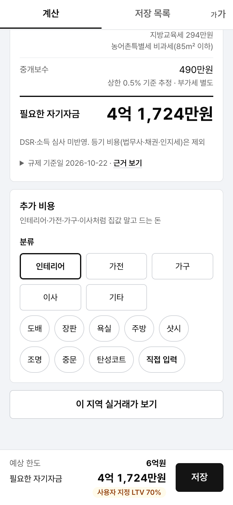
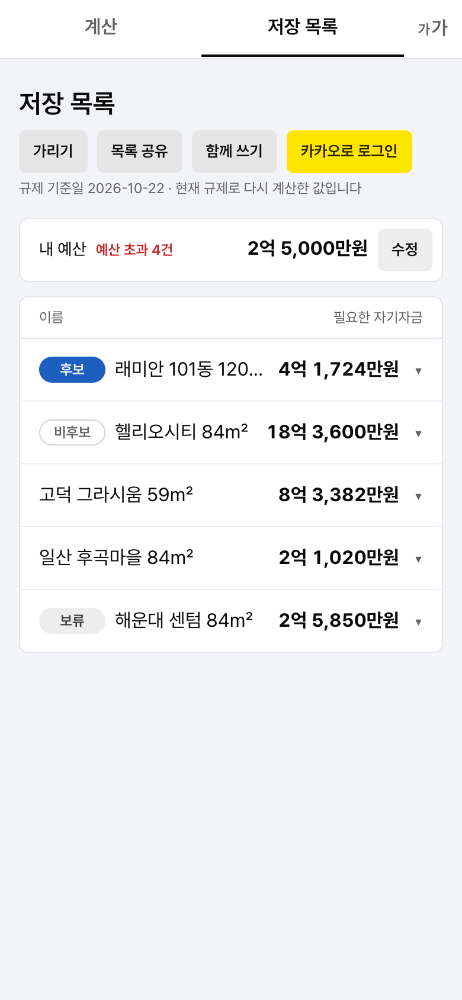
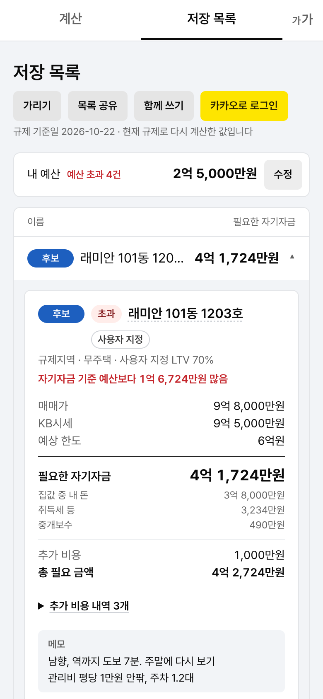

# 모기지핏 (mortgage-fit)

매매가와 KB시세를 넣으면 주택담보대출 예상 한도와 필요한 자기자금(취득세·중개보수 포함)을 계산해 주는 휴대폰용 웹앱입니다.

운영 주소: <https://loan.conychoi.dev>

## 화면

<table>
  <tr>
    <td align="center"><br />계산 입력</td>
    <td align="center"><br />계산 결과·추가 비용</td>
    <td align="center"><br />저장 목록</td>
  </tr>
  <tr>
    <td align="center"><br />매물 카드</td>
    <td align="center"><br />실거래가</td>
    <td align="center"><br />스크린샷으로 채우기</td>
  </tr>
</table>

화면의 매물 이름과 금액은 예시입니다.

## 주요 기능

- **한도·자기자금 계산**: 매매가, KB시세, 주택 소재지, 보유 상태, 전용 85㎡ 초과 여부를 넣으면 예상 한도와 필요한 자기자금을 바로 보여 줍니다.
- **LTV 선택**: 40%·70%·80% 칩, 직접 입력, 규제대로 중에서 고릅니다. 사용자 지정 LTV를 쓰면 규제 기준 LTV를 함께 보여 줍니다.
- **KB시세 확인 링크**: KB시세는 자동으로 가져오지 않습니다. 링크로 KB부동산을 열어 확인한 뒤 입력합니다.
- **저장 목록**: 계산한 매물을 저장하면 한 줄씩 보이고, 줄을 누르면 상세 카드가 펼쳐집니다. 줄을 꾹 눌러 끌어 순서를 직접 정합니다. 저장된 매물은 현재 규제로 다시 계산해 보여 줍니다.
- **상태·이름·메모**: 매물마다 후보·보류·비후보를 정하고, 카드 제목을 눌러 이름을 바로 바꾸고, 메모(5,000자)를 남깁니다. 긴 메모는 접어 둡니다.
- **추가 비용**: 인테리어·가전·가구·이사·기타 비용을 줄 단위로 적으면 필요한 자기자금과 별도로 총 필요 금액을 보여 줍니다.
- **내 예산**: 예산을 입력하면 필요한 자기자금이 예산을 넘는 매물에는 [초과]와 넘는 금액을 빨간색으로, 예산 안인 매물에는 남는 금액을 파란색으로 표시합니다.
- **가리기·글자 크기**: [가리기]를 켜면 금액과 메모를 `•••`로 가립니다. 탭바의 [가가]로 글자 크기(기본·작게·더 작게)를 고릅니다.
- **카카오 로그인·함께 쓰기**: 로그인하면 목록·예산·순서가 계정에 저장돼 어느 기기에서든 같습니다. 처음 로그인할 때 기기에 있던 목록을 계정으로 옮깁니다(기기 원본은 그대로). [함께 쓰기] 초대 링크로 두 계정이 한 목록을 같이 편집합니다.
- **공유 링크**: 목록이나 매물 하나를 링크로 보내면 받은 사람이 값만 복사해 자기 목록에 추가합니다.
- **스크린샷으로 채우기**: 네이버부동산 매물 상세 화면 캡처를 올리면 매매가, 단지명, 면적을 읽어 미리 보여 주고, [적용]을 눌러야 입력에 반영합니다.
- **실거래가 보기**: 시군구와 단지명으로 국토교통부 아파트 매매 실거래가(최근 3개월)를 조회합니다. KB시세가 아니며 계산에 반영하지 않습니다.

## 계산 방식

금액은 만원 단위입니다.

| 항목            | 계산                                                                               |
| --------------- | ---------------------------------------------------------------------------------- |
| 기준 금액       | min(매매가, KB시세)                                                                |
| 예상 한도       | 기준 금액 × LTV. 한도 상한이 있는 지역(규제지역·수도권)에서는 상한을 넘지 않습니다 |
| 집값 중 내 돈   | 매매가 − 예상 한도                                                                 |
| 취득세 등       | 취득세 + 지방교육세 + 농어촌특별세(전용 85㎡ 초과만)                               |
| 중개보수        | 거래금액 구간별 상한 요율 기준 추정. 부가세 별도                                   |
| 필요한 자기자금 | 집값 중 내 돈 + 취득세 등 + 중개보수                                               |

DSR·소득 심사와 등기 비용(법무사·채권·인지세)은 반영하지 않습니다.

LTV·한도 상한·세율·요율과 각 수치의 출처, 기준일은 결과 카드의 **근거 보기**에서 확인할 수 있습니다. 코드에서는 아래 상수 파일에 모여 있습니다.

- 대출 규제(LTV, 한도 상한): `src/lib/constants/loanRegulations.ts`
- 취득세·중개보수: `src/lib/constants/purchaseCosts.ts`

> 참고용 계산입니다. 실제 대출 한도는 금융기관에, 세금은 세무서나 지방자치단체에 확인하세요.

## 개인정보

- 로그인하지 않으면 저장 목록, 예산, 작성 중인 입력은 이 브라우저의 localStorage에만 저장하고 서버로 보내지 않습니다.
- 카카오로 로그인하면 저장 목록·예산·순서를 서버(Cloudflare D1)에 저장합니다. 카카오에서는 회원번호만 받고 이름·이메일은 받지 않습니다. 작성 중인 입력은 계속 기기에만 둡니다.
- 공유 링크를 만들면 그 매물 값(메모는 선택한 경우만)이 30일 동안 서버에 보관됩니다.
- 스크린샷은 기기 안에서 글자를 읽고(tesseract.js) 어디에도 업로드하지 않습니다.
- 실거래가 조회는 고른 시군구 코드와 단지명만 서버(`/api/apt-trades`)로 보냅니다.

## 개발

Vite + React 클라이언트를 Cloudflare Workers Static Assets로 서비스하고, 같은 Worker가 `/api/apt-trades`(국토교통부 실거래가 프록시)를 처리합니다. 진입점은 `worker/index.ts`, API 로직은 `server/`에 있습니다.

### 로컬 실행

- 화면만: `pnpm dev`. `/api` 요청은 Vite proxy가 `http://localhost:8788`로 넘깁니다.
- API 포함: 터미널 두 개를 씁니다.
  1. `pnpm dev:api` — `wrangler dev --port 8788`. 시작할 때 `wrangler.jsonc`의 `build.command`(`pnpm build`)로 `dist`를 만들고, `src/`가 바뀌면 다시 빌드합니다. 화면 작업은 Vite(터미널 2)로 봅니다.
  2. `pnpm dev`
- 서비스키: 프로젝트 루트 `.dev.vars`에 `MOLIT_SERVICE_KEY=<공공데이터포털 Decoding 키>`를 둡니다(`.dev.vars.example` 참고, git 제외). `.env`와 함께 쓰지 않습니다. 키가 없으면 API는 503 `notConfigured`를 돌려줍니다.

### 배포

Workers Builds(GitHub 연결)가 `wrangler deploy`(비프로덕션 브랜치는 `wrangler versions upload`)를 실행하고, 이때 `build.command`가 먼저 돕니다. 시크릿 `MOLIT_SERVICE_KEY`는 Worker의 Settings → Variables and Secrets에 Secret으로 등록합니다.

### 검증

```bash
pnpm lint
pnpm format:check
pnpm test
pnpm build
pnpm build:worker                                  # wrangler deploy --dry-run(배포·로그인 없음)
bash scripts/smoke-api.sh                          # pnpm dev:api가 떠 있을 때. 키 없음: 400·405·503
bash scripts/smoke-api.sh http://localhost:8788 key   # 키 있음: 400·405·200, 응답에 키 없음
node scripts/probeUpstream.ts [LAWD_CD ...]        # 업스트림 원문 확인(.wrangler/probe/)
```

## 기술 스택

- 클라이언트: React 19, TypeScript, Vite, TanStack Query, CSS Modules
- 스크린샷 인식: tesseract.js(한국어 데이터, 브라우저 안에서 실행)
- 서버: Cloudflare Workers(정적 자산 + 실거래가 API 프록시)
- 테스트: Vitest, Testing Library
